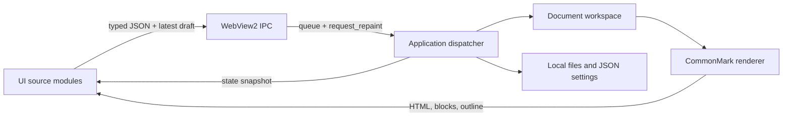

# Markora architecture

Markora is a local desktop editor. eframe owns the native window; wry embeds the
HTML interface as a WebView2 child. The Rust workspace owns documents and files.
The browser owns transient editing state, selections, menus, and dialogs.
On Linux, the same workspace and command handlers drive the native egui source
editor. `src/webview_fallback.rs` selects that interface without linking wry,
WebKit or GTK. The full web interface is currently Windows-only.

## Rust modules

| File                              | Responsibility                                          |
| --------------------------------- | ------------------------------------------------------- |
| `src/main.rs`                     | Window configuration and startup                        |
| `src/app.rs`                      | Lifecycle, frame processing, close interception         |
| `src/app/bridge.rs`               | Deserialize requests, apply drafts, build snapshots     |
| `src/app/commands.rs`             | Native commands and unsaved-change state machine        |
| `src/app/files.rs`                | File/folder dialogs, open/save, recents                 |
| `src/app/sidebar.rs`              | Lazy folder branches, stale-result guards and native file tree |
| `src/app/export.rs`               | Exports and acknowledged print/PDF preparation          |
| `src/app/fallback.rs`             | Native source editor when WebView2 is unavailable       |
| `src/app/reading.rs`              | Transient reading state and native fullscreen lifecycle |
| `src/webview_keys.rs`             | F11 and PDF reading Escape through WebView2 accelerators |
| `src/model.rs`                    | Documents, revisions, dirty tracking, tabs, preferences |
| `src/markdown.rs`                 | CommonMark/GFM HTML, source block ranges, outline       |
| `src/protocol.rs`                 | Serde request and snapshot types                        |
| `src/storage.rs`                  | Settings persistence and filesystem operations          |
| `src/file_io.rs`                  | Same-directory atomic writes and content fingerprints   |
| `src/recovery.rs`                 | Versioned sessions, exclusive lock and ordered writer   |
| `src/app/session.rs`              | Startup restore, checkpoint scheduling and exit flush   |
| `src/app/safety.rs`               | Background file scans and external-change resolution    |
| `src/app/conflict.rs`             | Conflict choices, close continuation and native dialog  |
| `src/app/save.rs`                 | Save dialogs, checked writes and saved baselines        |
| `src/image_assets.rs`             | Bounded decoding, hashed asset names and immutable writes |
| `src/image_assets/relocate.rs`    | Referenced imported-asset copying for Save As             |
| `src/image_protocol.rs`           | Transfer limits, sequencing and acknowledgements          |
| `src/app/images.rs`               | Import jobs, stale-result checks and native insertion     |
| `src/webview_drop.rs`             | Single native file-drop route through the host            |
| `src/webview_host.rs`             | Child webview, IPC wakeup, bounds and message delivery  |
| `src/webview_fallback.rs`         | Non-Windows adapter selecting the native source editor  |
| `src/theme.rs`, `src/platform.rs` | Native styling/fonts and external URL opening           |

The library (`src/lib.rs`) exposes the model, parser, protocol and storage so
integration tests call production code. Host tests exercise the real command
dispatcher and close flow without creating a window.

## Frontend sources

Edit `assets/ui/shell.html`, the files in `assets/ui/src/`, and the stylesheets in
`assets/ui/styles/`. `assets/ui/index.html` and `tailwind/app.built.css` are generated.

| Module                           | Responsibility                                                       |
| -------------------------------- | -------------------------------------------------------------------- |
| `main.js`                        | Connect the frontend modules                                         |
| `bridge.js`                      | Native transport, startup handshake, draft attachment                |
| `command-list.js`, `commands.js` | Shared command catalog, menus, shortcuts, dispatch                   |
| `editor.js`                      | Document draft, revisions, source/split editing, formatting, history |
| `live-editor.js`                 | Rendered blocks with an active Markdown textarea                     |
| `markdown-keys.js`, `table-editing.js` | Shared Markdown keyboard edits, list continuation, indentation and table navigation |
| `editor-position.js`, `live-position.js` | Per-tab selections, pane scroll and Live block restoration after layout |
| `edit-mode.js`                   | Explicit Live edit gate and read-only controls                       |
| `sidebar.js`                     | Accessible lazy file tree and collapsible recent-files panel         |
| `layout.js`                      | Responsive sizing, pointer/keyboard resizers and saved widths        |
| `reading.js`                     | Read-only preview presentation and editor focus/selection/scroll restore |
| `chrome.js`                      | Tabs, outline, status, themes and sidebar snapshots                   |
| `dialogs.js`, `find.js`          | Modal UI, palette, settings and document search                      |
| `search-engine.js`               | Unicode-aware matching, bounded replacement and regex captures       |
| `search-worker.js`               | Cancellable worker execution with search timeouts                    |
| `conflicts.js`                   | External file-change dialog and resolution actions                   |
| `dom.js`                         | Small shared DOM helpers                                             |

## Data flow and invariants

1. Every user action carries its document ID, latest Markdown and revision. Rust
   applies that draft before save, tab activation, close, or command execution.
2. Every IPC arrival requests an egui repaint. Commands work while the parent
   window is otherwise idle. There is no continuous frame polling requirement.
3. The page retries its readiness handshake until it receives a state snapshot.
   Host messages are sent only after that handshake, when the receiver exists.
4. Revisions prevent stale drafts from replacing newer content. Frontend echoes
   do not replace an active textarea or reset its cursor.
   Tab positions are browser-session state keyed by document ID and removed when
   tabs close. Source/Split retain selection direction and both scroll axes;
   Live retains its edit gate, source selection and visible block anchor. Pending
   restoration waits for matching rendered Markdown and checks the active tab
   before applying. Reading preview positions are also kept per tab. The native
   fallback uses document-specific egui editor and scroll IDs.
5. One Rust CommonMark parser generates preview HTML, live blocks, and outline.
   Block offsets sent to JavaScript use UTF-16 positions, including emoji.
6. Live editing splices the active block's Markdown into its original source
   range. It does not reconstruct Markdown from rendered DOM.
7. Closing a tab checks that tab. Closing all tabs or exiting considers every
   dirty document and offers Save, Discard, or Cancel inside the visible UI.
8. Grid columns have explicit placement, so hiding a sidebar frees its width.
   No editor view has a fixed maximum document width.
9. Find and replace searches the Markdown model in a Blob worker, bundled fully
   offline. Results are accepted only for the originating document, revision,
   query and options. Changing the query or closing the bar cancels outstanding
   work. Regex execution has a 1.5-second timeout; truncated match sets cannot
   be replaced in bulk. A replacement updates the document once through the
   editor's normal revision/history/IPC flow, making Replace All one undo step.

F11 goes through the shared command catalog. WebView2 native accelerators forward
F11 (and Escape while reading a PDF) to the page after their COM callback returns;
the page sends a normal command with its latest draft. Rust owns transient reading
state, prepares deferred Source rendering and requests native fullscreen through
egui. State snapshots drive `reading.js`, which reuses the existing preview and
keeps the Live/Source/Split mode and saved preferences intact. Winit restores native
window placement on fullscreen exit. The frontend preserves editing focus,
selection and scroll; find navigates rendered source-block anchors while mutation
commands and pending replacements are disabled. The mode is not persisted.

## Build and persistence

`markdown-keys.js` computes UTF-16 text/selection changes for Source, Split and
both existing and appended Live block textareas. Live supplies the preceding
document source so fenced-code detection uses document context. `table-editing.js`
recognizes header/separator tables and escaped pipes, selects cells and appends
rows. Navigation only changes selection; mutations dispatch one normal input
event through the existing revision/history/preview/save flow. Read-only states,
composition and modified system shortcuts bypass the handler.

`node tools/build-ui.cjs` compiles Tailwind, bundles the named-import JavaScript
modules, and validates their dependency order. Rust embeds the HTML and fonts,
serving them through the local asset protocol. Fonts load on demand and HTML
responses bypass the browser cache so updates are visible after a restart.
There is no runtime Node or web-server dependency.

File reads and preparation run on background threads, overlapping WebView2
startup for command-line files. Large Source documents defer HTML generation;
Live inserts blocks in frame batches. State snapshots omit unchanged document
content and reuse the browser's current draft. Printing explicitly waits for
the browser to prepare the full preview before invoking the native print API.

`cargo build` embeds that generated asset. Debug builds read the on-disk bundle
on startup; release builds use the embedded copy. Rebuild the UI before Cargo
when changing frontend sources. The watch command rebuilds sources automatically;
restart the app to load a new bundle.

Settings and recents use a `.markora/` directory alongside the `markora`
executable, with an AppData fallback when that directory cannot be created.
`MARKORA_DATA_DIR` overrides settings storage for isolated runs. Documents are
saved to their selected paths; they are not stored inside the preferences files.

`session.json` separately stores Markdown drafts, their last saved baseline and
disk content fingerprint, plus tab order, selection, view modes and folder.
Clean files reopen from disk; dirty drafts retain their original fingerprint so
offline changes still require review. An exclusive `session.lock` file lock
prevents multiple instances from overwriting the same recovery session. Corrupt
or unknown-version sessions disable recovery writes and retain the original.
One worker serializes checkpoints through a bounded queue; an explicit exit
waits for its final checkpoint. Discarded untitled drafts are omitted, and
discarded file-backed drafts restore from disk. Cancel leaves drafts intact.

The event loop requests a repaint every 500 ms to schedule recovery and file
monitoring. A debounced checkpoint runs after 750 ms of inactivity, with a
two-second maximum scheduling interval while typing. File content fingerprints
are scanned off the UI thread every two seconds; results with an outdated path
or baseline are ignored. Saves compare the expected fingerprint both before
writing the temporary file and immediately before replacement. This is
optimistic conflict detection, not an exclusive lock on other applications.

## Image importing

`images.js` captures the document ID, revision and UTF-16 selection through
`editor-images.js`. Begin applies the current draft and obtains a save path if
needed. Browser blobs travel in acknowledged 256 KiB chunks without repeating
the document draft on every chunk. Rust enforces declared sizes and ordering.
Native file drops use Wry's handler and block default OS handling to prevent
duplicate browser/parent processing. Fallback drops use the same importer.

The worker validates a complete batch before writing files. It preserves image
bytes under SHA-256 names, syncs a temporary file and publishes without replacing
an existing destination. The UI inserts returned links through normal history
and draft synchronization only when the captured document and revision match.
Otherwise, it offers a new selection in the original note. Assets persist through
Undo and discarded drafts; automatic cleanup is intentionally absent.

Save As parses Markdown image references and copies only managed image filenames
whose content matches their hash, then rewrites links according to the current
per-file, shared data.assets or custom folder policy. `asset_policy.rs` handles
destination paths and cross-drive file URLs. `app/asset_settings.rs` persists
preferences and the exact imported-file allowlist in `imported-images.json`.
The allowlist permits existing external images after a folder-setting change
without enabling arbitrary traversal. Relative paths use an opaque protocol
segment so browser URL normalization cannot remove parent components.
Source and destination checks constrain ordinary asset folders. URL normalization encodes segments once,
including existing percent escapes, spaces and Unicode. Clipboard imports in
the native source fallback require a future platform adapter. `live-tasks.js`
keeps checkbox edits separate from Live block editing and image selection.

## Verification

- `cargo test`: production model, parser, storage, protocol and host regressions.
- `cargo clippy --all-targets -- -D warnings`: Rust checks.
- `node tools/verify-ui.cjs`: bundle syntax, IDs, embedded fonts, 300-line module limit.
- `node tools/smoke-native.cjs`: actual Rust + WebView2 menus, shortcuts, palette,
  editing, resizing, fullscreen reading and window restoration, width, unsaved
  changes and file save. Requires Windows.
- `node tools/smoke-safety.cjs`: external conflicts, Live reload, forced shutdown,
  restored tabs/drafts and graceful-exit discard in real WebView2 processes.
- `node --test tools/test-images.cjs`: source selections, stale revisions and URL normalization.
- `node tools/smoke-images.cjs`: real OS image clipboard and OLE drop, preview,
  Undo/Redo, chunked transfers, retry and native save dialogs. Uses isolated
  fixtures and restores the clipboard after testing.
- `node tools/smoke-images.cjs --dom`: WebView2 clipboard events and native-path
  routing without OS input; also exercises all folder policies through Settings.
- `node --test tools/test-search.cjs`: production search semantics, Unicode
  boundaries/offsets, capture substitutions and result limits.
- `node tools/smoke-find.cjs`: real WebView2 find/replace, navigation, undo/save,
  regex timeouts/cancellation, stale-result rejection and Live/Source/Split.
- `node tools/smoke-position.cjs`: per-tab selections, independent Source/Split
  scroll, deep Live anchors and editing, reading transitions, rapid activation,
  closed-tab cleanup and empty paragraphs in real WebView2.

The native suite creates fixtures, settings and WebView2 data under
`target/ui-smoke/<run>/` and never uses the normal preferences directory. It also
saves screenshots and runtime diagnostics there. Its DevTools port exists only
for the lifetime of its isolated test process.
